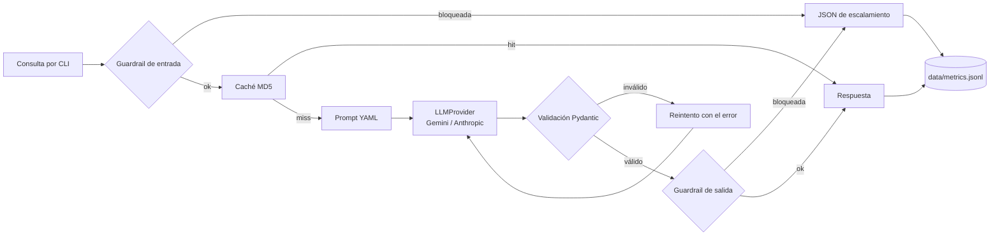
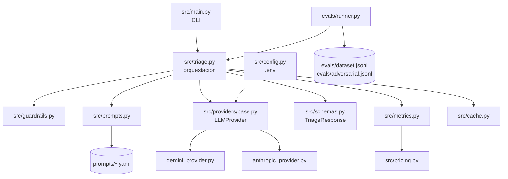

# Nubbix Triage — Soporte nivel 1 con LLMs

Servicio de línea de comandos que recibe una consulta de soporte en texto libre, la clasifica, propone una respuesta y sugiere acciones al agente humano. Devuelve siempre un JSON validado, registra tokens, latencia y costo de cada request, y resiste entradas maliciosas.

Proyecto Integrador del Módulo 1 — AI Engineering (Henry).

> **Estado:** en construcción, commit a commit. Este README describe el plan y la arquitectura objetivo. Las secciones de uso, resultados y decisiones se completan a medida que avanza cada etapa.

---

## 1. Vista de producto

### El problema

Nubbix es un SaaS de gestión para pymes de LATAM con 12.000 clientes.

| Indicador | Valor actual |
|---|---|
| Tickets por día | ~400 |
| Tickets repetitivos (4 tipos) | 60 % (~240 por día) |
| Tiempo de primera respuesta | 9 horas |
| Equipo de nivel 1 | Saturado |

### La solución

Un servicio que hace el primer paso del trabajo del agente de nivel 1:

1. **Clasifica** la consulta en `billing`, `technical`, `account` u `other`.
2. **Propone una respuesta** lista para revisar y enviar.
3. **Sugiere acciones** concretas para el agente (por ejemplo, "verificar cargos duplicados en el panel de pagos").
4. **Indica su confianza**, para que el agente sepa cuándo revisar con más cuidado.

El agente humano sigue teniendo la última palabra. El servicio no responde solo al cliente: le ahorra al agente el tiempo de leer, clasificar y redactar desde cero.

### Usuarios

| Usuario | Qué necesita |
|---|---|
| Agente de soporte nivel 1 | Una clasificación correcta y un borrador de respuesta que pueda usar |
| Líder de soporte | Saber cuánto cuesta el servicio, cuánto tarda y qué tan bien clasifica |
| Sistema de tickets (consumidor del JSON) | Un contrato estable que no cambie ni se rompa |
| Equipo de seguridad | Garantía de que un cliente malicioso no puede manipular el sistema |

### Cómo medimos el éxito

| Pregunta de negocio | Métrica del proyecto |
|---|---|
| ¿Clasifica bien? | Accuracy global y por categoría en el dataset de evals |
| ¿El sistema de tickets puede consumir la salida? | % de respuestas con JSON válido (objetivo: 100 %) |
| ¿Cuánto cuesta? | Costo en USD por request y por corrida de evals |
| ¿Es rápido? | Latencia por request, en segundos |
| ¿Es seguro? | % de ataques de la suite adversarial bloqueados |

### Alcance

**Incluye:** CLI, dos proveedores de LLM intercambiables, prompts versionados, dataset de evaluación, runner de evals, métricas en JSONL, guardrails de entrada y salida, suite adversarial, caché y comparativa de modelos.

**No incluye:** integración real con el sistema de tickets, envío automático de respuestas al cliente, interfaz web, base de datos, RAG (eso llega en el Módulo 2).

---

## 2. Vista técnica y de arquitectura

### Contrato de salida

Todo request devuelve exactamente este JSON, también cuando hay un error o un bloqueo de seguridad:

```json
{
  "answer": "Hola, lamentamos el doble cobro. Ya derivamos tu caso al equipo de facturación...",
  "confidence": 0.92,
  "category": "billing",
  "actions": [
    "Verificar cargos duplicados del mes en el panel de pagos",
    "Iniciar reintegro del cargo duplicado"
  ]
}
```

| Campo | Tipo | Regla |
|---|---|---|
| `answer` | `string` | No vacío |
| `confidence` | `float` | Entre 0 y 1 |
| `category` | `string` | Uno de `billing`, `technical`, `account`, `other` |
| `actions` | `list[string]` | Al menos una acción |

### Flujo de un request



### Componentes



| Módulo | Responsabilidad |
|---|---|
| `src/main.py` | Leer argumentos de la CLI e imprimir el JSON |
| `src/triage.py` | Orquestar el flujo: guardrails, prompt, LLM, validación, métricas |
| `src/providers/` | Una clase por proveedor detrás de la interfaz `LLMProvider` |
| `src/schemas.py` | Contrato `TriageResponse` en Pydantic |
| `src/prompts.py` | Cargar y renderizar la versión de prompt elegida |
| `src/guardrails.py` | Detección de injection, moderación y validación de la salida |
| `src/metrics.py` | Escribir una línea por request en `data/metrics.jsonl` |
| `src/pricing.py` | Precios por modelo, con fuente y fecha |
| `src/cache.py` | Caché por hash MD5 de consulta + prompt + modelo |
| `evals/runner.py` | Correr el dataset y reportar score global y por categoría |

### Decisiones técnicas

| Decisión | Elección | Motivo |
|---|---|---|
| Lenguaje | Python 3.12 | Pydantic y los SDK oficiales de ambos proveedores |
| Proveedores | Gemini y Anthropic | Dos SDK oficiales con APIs distintas: obligan a una abstracción real |
| Modelos | `gemini-3.1-flash-lite` y `claude-haiku-5-5` | Los más económicos y vigentes de cada marca (verificado el 2026-10-29). Gemini tiene capa gratuita: las pruebas cuestan $0. Se descartó `gpt-5-nano` porque OpenAI lo apaga el 2026-12-11 |
| Abstracción | Interfaz mínima `LLMProvider` | Cambiar de proveedor sin tocar la lógica de negocio, sin armar un framework |
| Validación | Pydantic + reintento con el error | El modelo no siempre respeta el contrato; el error le indica qué corregir |
| Prompts | Archivos YAML versionados | El prompt se trata como código y se compara con datos |
| Métricas | JSONL append-only | Simple y auditable; la consigna pide no usar base de datos |
| Costo | Precio por MTok guardado en cada línea | Cualquiera puede recalcular el costo y llegar al mismo número |
| Seguridad | Defensa en capas | Un solo guardrail se evade con variaciones triviales |
| Evals | Script simple | La complejidad va en el prompt y los evals, no en las herramientas |

### Estructura del repositorio (objetivo)

```text
.
├── src/
│   ├── main.py
│   ├── triage.py
│   ├── config.py
│   ├── schemas.py
│   ├── prompts.py
│   ├── guardrails.py
│   ├── metrics.py
│   ├── pricing.py
│   ├── cache.py
│   └── providers/
│       ├── base.py
│       ├── gemini_provider.py
│       └── anthropic_provider.py
├── prompts/
│   ├── v1.yaml          # zero-shot (línea base)
│   └── v2.yaml          # few-shot + reglas
├── evals/
│   ├── dataset.jsonl
│   ├── adversarial.jsonl
│   ├── runner.py
│   └── results/
├── data/
│   └── metrics.jsonl
├── docs/
│   └── ai-usage.md
├── .env.example
├── requirements.txt
└── README.md
```

---

## 3. Plan de construcción

El proyecto se construye en 20 commits chicos. Cada commit agrega una sola pieza, se explica y se verifica antes de pasar al siguiente.

| Etapa | Commits | Resultado | Criterio de la rúbrica |
|---|---|---|---|
| A. Base del repo | 1–2 | Repo autocontenido, configuración por `.env` | Repositorio |
| B. Flujo principal | 3–6 | **Hito 1:** la CLI devuelve JSON válido | Funcionalidad y contrato |
| C. Robustez | 7–9 | Dos proveedores, reintento, manejo de errores | Funcionalidad y contrato |
| D. Observabilidad | 10–11 | **Hito 2:** métricas en `data/metrics.jsonl` | Observabilidad |
| E. Prompts y evals | 12–16 | **Hito 3:** comparativa v1 vs v2 con datos | Evals y prompting |
| F. Seguridad | 17–19 | Guardrails y suite adversarial | Seguridad |
| G. Cierre | 20 + docs | Caché, comparativa de modelos, README final | Extra credits |

| # | Commit |
|---|---|
| 1 | `chore: estructura inicial, gitignore y dependencias` |
| 2 | `chore: configuración por variables de entorno` |
| 3 | `feat: contrato TriageResponse con Pydantic` |
| 4 | `feat: interfaz LLMProvider` |
| 5 | `feat: proveedor Gemini` |
| 6 | `feat: CLI básica de triage` |
| 7 | `feat: proveedor Anthropic y selección por --provider` |
| 8 | `feat: reintento ante JSON inválido` |
| 9 | `feat: manejo de errores de API` |
| 10 | `feat: tabla de precios por modelo` |
| 11 | `feat: registro de métricas en JSONL` |
| 12 | `feat: prompts versionados en YAML (v1 zero-shot)` |
| 13 | `feat: prompt v2 few-shot con reglas` |
| 14 | `feat: dataset de evaluación (≥30 casos)` |
| 15 | `feat: runner de evals con score global y por categoría` |
| 16 | `docs: comparativa v1 vs v2 y elección de prompt` |
| 17 | `feat: guardrail de entrada en capas` |
| 18 | `feat: guardrail de salida y token canario` |
| 19 | `feat: suite adversarial (bonus)` |
| 20 | `feat: caché MD5 + comparativa de modelos` |

---

## 4. Instalación y uso

### Requisitos

- Python 3.12 y [uv](https://docs.astral.sh/uv/) (o `pip`).
- Una API key de al menos un proveedor: Gemini (gratis en [Google AI Studio](https://aistudio.google.com)) o Anthropic ([platform.claude.com](https://platform.claude.com)).

### Instalación

```bash
uv venv --python 3.12 .venv
source .venv/bin/activate
uv pip install -r requirements.txt
cp .env.example .env    # completar las API keys en .env
```

La terminal debe tener el entorno activo (`(.venv)` en el prompt) para correr los comandos de abajo.

### Clasificar un ticket

```bash
python -m src.main "me cobraron dos veces la suscripción de este mes" --provider anthropic
```

```json
{
  "answer": "Lamentamos el cobro duplicado de tu suscripción de este mes. Nuestro equipo de facturación va a revisar los pagos registrados en tu cuenta y te confirmaremos el resultado; ¿puedes indicarnos la fecha y el monto de ambos cargos?",
  "confidence": 0.95,
  "category": "billing",
  "actions": [
    "Revisar en el historial de pagos del cliente si hay dos cargos de la suscripción del mes",
    "Verificar la fecha, el monto y el estado de cada cargo",
    "Iniciar el proceso de reintegro del cargo duplicado si se confirma la duplicidad"
  ]
}
```

| Opción | Valores | Por defecto |
|---|---|---|
| `--provider` | `gemini`, `anthropic` | `LLM_PROVIDER` en `.env` (`gemini`) |
| `--prompt` | `v1`, `v2` (archivos de `prompts/`) | `v2` |

- **stdout** recibe solo el JSON del contrato, listo para otro sistema. Los avisos y errores van a **stderr**.
- **Código de salida:** `0` si el modelo respondió bien; `1` si falló. En ese caso igual se imprime un JSON de respaldo con `confidence: 0` para revisión humana.
- Cada ejecución agrega una línea a `data/metrics.jsonl`. Para leerlas: `jq . data/metrics.jsonl`.

### Correr los evals

```bash
python -m evals.runner --provider anthropic --prompt v2
```

Imprime el score global y por categoría, y guarda el detalle por caso en `evals/results/`. Con `--limit N` corre solo los primeros N casos, para una prueba rápida.

Con la capa gratuita de Gemini conviene espaciar las llamadas para no superar el rate limit:

```bash
python -m evals.runner --provider gemini --prompt v2 --delay 4
```

## 5. Resultados de evals

**Dataset:** [`evals/dataset.jsonl`](evals/dataset.jsonl), con 40 tickets ficticios etiquetados a mano: 10 por categoría. Incluye casos claros (25), informales o con errores de tipeo (6), ambiguos o con dos temas (7), vagos (2) y uno en inglés. Varios casos son "trampas" con palabras de otra categoría (por ejemplo, un error 403 al generar una factura es `technical`, no `billing`).

**Métrica principal:** accuracy de `category`. Un ticket cuenta como acierto si el modelo devolvió JSON válido y la categoría esperada.

### v1 contra v2 (Anthropic, `claude-haiku-5-5`)

| Métrica | v1 zero-shot | v2 few-shot + reglas |
|---|---|---|
| **Accuracy global** | 90,0 % | **97,5 %** |
| billing | 100 % | 100 % |
| technical | 80 % | 90 % |
| account | 100 % | 100 % |
| other | 80 % | 100 % |
| Casos ambiguos (n=5) | 60 % | **100 %** |
| JSON válido | 100 % | 100 % |
| Reintentos | 0 | 0 |
| Confianza media en aciertos / errores | 0,75 / 0,66 | 0,86 / 0,70 |
| Latencia media | 3,23 s | **2,52 s** |
| Tokens por ticket (entrada / salida) | 561 / 536 | 1.864 / 421 |
| Costo por ticket | $0,00032 | $0,00040 |
| Costo de la corrida (40 casos) | $0,0130 | $0,0159 |

Fuente: [`evals/results/dataset_anthropic_v1.json`](evals/results/dataset_anthropic_v1.json) y [`dataset_anthropic_v2.json`](evals/results/dataset_anthropic_v2.json). v1 se corrió 2 veces y dio el mismo 90 % con los mismos 4 errores.

**Errores de v1:** `technical-04` (error 403 tomado como permisos de cuenta), `technical-09` (falla de sincronización con Mercado Pago tomada como cobro), `other-03` (consulta de precios antes de contratar tomada como facturación) y `other-09` (pregunta comercial sobre la API tomada como técnica).

**Error de v2:** solo `technical-04`. Es un caso discutible: un 403 puede leerse como falta de permisos.

### Decisión: v2 es el prompt por defecto

- **Clasifica mejor:** +7,5 puntos en total, y resuelve todos los casos ambiguos, que son donde v1 fallaba.
- **Es más rápido:** 22 % menos de latencia, porque escribe respuestas más cortas.
- **Su confianza es más útil:** separa más los aciertos (0,86) de los errores (0,70).
- **Cuesta 23 % más por ticket:** los 4 ejemplos agregan unos 1.300 tokens de entrada por request. Para el volumen de Nubbix (400 tickets por día) son unos $4,80 por mes con v2 contra $3,90 con v1. La mejora en calidad justifica esa diferencia.

**Técnica de context engineering elegida: few-shot con reglas explícitas.** Los ejemplos fijan el formato y el criterio de clasificación; las reglas cierran los problemas observados en v1 (inventar menús y herramientas, voseo, promesas al cliente, respuestas largas). Cada regla de [`prompts/v2.yaml`](prompts/v2.yaml) está asociada al problema que corrige en el comentario inicial del archivo.

**Limitaciones de esta comparación:**
- 40 casos son pocos: un caso equivale a 2,5 puntos. La diferencia entre v1 y v2 (3 casos) es consistente, pero no estadísticamente fuerte.
- Las etiquetas las puso una sola persona; en los casos ambiguos otra persona podría decidir distinto (ver el campo `note` del dataset).
- 2 casos (`account-09`, `technical-09`) se parecen a reglas de desempate de v2. Sin ellos, v2 sigue ganando: 97,4 % contra 92,1 %.

### Mismo prompt, 2 modelos

| Métrica | Haiku 5.5 · v1 | Haiku 5.5 · v2 | Gemini 3.1 Flash-Lite · v1 | Gemini 3.1 Flash-Lite · v2 |
|---|---|---|---|---|
| **Accuracy global** | 90,0 % | **97,5 %** | 92,5 % | **97,5 %** |
| Casos ambiguos (n=5) | 60 % | 100 % | 60 % | 80 % |
| JSON válido | 100 % | 100 % | 100 % | 100 % |
| Confianza media en aciertos / errores | 0,75 / 0,66 | 0,86 / 0,70 | 0,98 / 0,98 | 0,93 / 0,95 |
| Latencia mediana / máxima | 3,2 s / 4,7 s | 2,4 s / 4,6 s | 1,3 s / 32,3 s | 3,9 s / 15,8 s |
| Tokens por ticket (entrada / salida) | 561 / 536 | 1.864 / 421 | 358 / 157 | 1.166 / 109 |
| Costo por ticket a precio pago | $0,00032 | $0,00040 | $0,00033 | $0,00046 |
| Costo real de la corrida | $0,013 | $0,016 | $0 (capa gratuita) | $0 (capa gratuita) |

Fuente: los 4 archivos de [`evals/results/`](evals/results/). Gemini se corrió con `--delay 4`; sin esa espera, una primera corrida tuvo 7 de 80 requests rechazados por la API, consistentes con el rate limit de la capa gratuita.

**Lectura:**
- **Calidad:** con v2 los 2 modelos empatan en 97,5 %. v2 mejora a los 2, lo que confirma que la mejora viene del prompt y no del modelo.
- **Costo pagando:** Haiku con v2 es 13 % más barato por ticket. Cada modelo cuenta tokens con su propio tokenizador (el mismo prompt v1 son 561 tokens en Haiku y 358 en Gemini), así que el costo solo se puede comparar midiendo, no estimando con los precios por token.
- **Costo en pruebas:** Gemini es gratis.
- **Confianza:** la de Haiku separa aciertos de errores. La de Gemini no sirve: puso 0,98 también en sus errores.
- **Latencia:** Haiku es estable. En la capa gratuita, Gemini tuvo picos de 15 a 32 segundos, probablemente por los reintentos automáticos del SDK ante el rate limit.

**Recomendación:** prompt v2 con Haiku 5.5 para producción (más barato pagando, confianza útil, latencia estable). Gemini con la capa gratuita para desarrollo y pruebas.

## 6. Seguridad

_Se completa en los commits 17 a 19._

## 7. Limitaciones

_Se completa al cierre._

## 8. Uso de IA en el desarrollo

_Se registra en `docs/ai-usage.md` a lo largo del proyecto._
