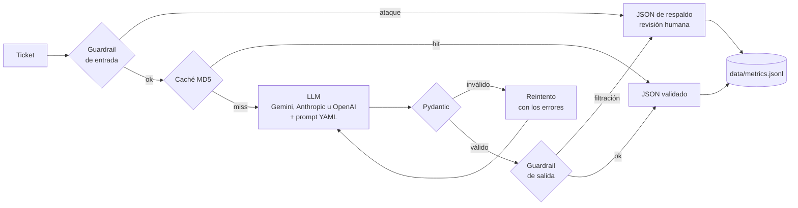
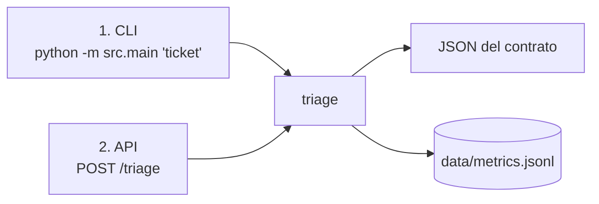
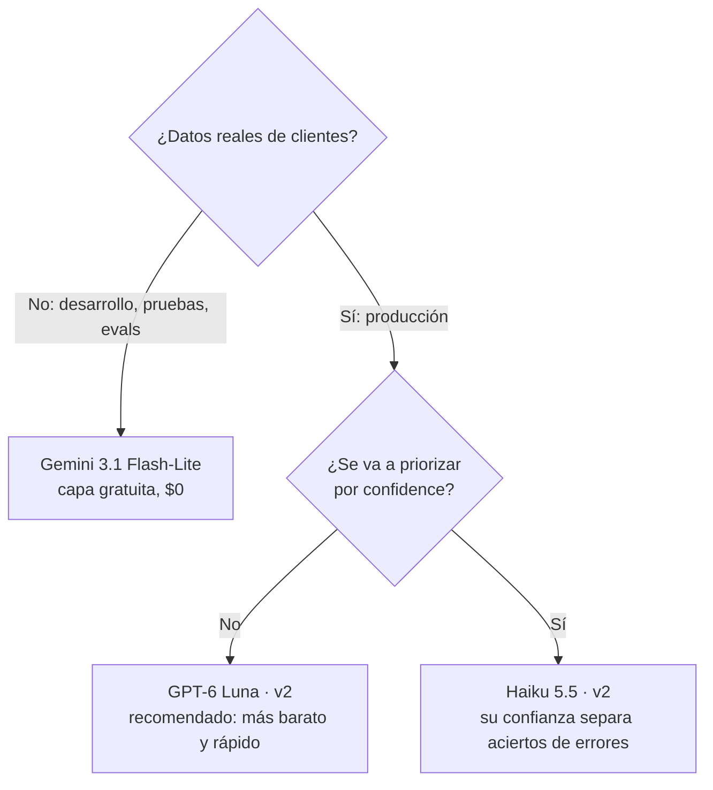

# Nubbix Triage

CLI que recibe un ticket de soporte en texto libre y devuelve, en JSON validado, su categoría, una respuesta propuesta para el cliente y acciones sugeridas para el agente humano. Registra tokens, latencia y costo de cada request, y bloquea intentos de manipulación.

Proyecto Integrador del Módulo 1 — AI Engineering (Henry). Caso: Nubbix, SaaS de gestión para pymes de LATAM con ~400 tickets por día y 9 horas de primera respuesta.

| Accuracy (prompt v2) | JSON válido | Costo por ticket (pago) | Ataques mitigados | Tests |
|---|---|---|---|---|
| 97,5–100 % en los 3 modelos | 100 % | $0,00017–$0,00046 | 30/30 con guardrails en los 3 modelos | 232, cobertura 99 % |

## Cómo funciona



Contrato de salida (no cambia nunca, ni siquiera ante errores):

```json
{
  "answer": "Lamentamos el cobro duplicado de tu suscripción de este mes. Nuestro equipo de facturación va a revisar los pagos registrados en tu cuenta y te confirmaremos el resultado; ¿puedes indicarnos la fecha y el monto de ambos cargos?",
  "confidence": 0.95,
  "category": "billing",
  "actions": [
    "Revisar en el historial de pagos del cliente si hay dos cargos de la suscripción del mes",
    "Verificar la fecha, el monto y el estado de cada cargo",
    "Iniciar el proceso de reintegro del cargo duplicado si se confirma la duplicidad"
  ]
}
```

`category` es `billing`, `technical`, `account` u `other`. `confidence` va de 0 a 1.

## Instalación

Requisitos: Python 3.12, [uv](https://docs.astral.sh/uv/) (o `pip`) y al menos una API key:

| Proveedor | Dónde se crea la key | Costo |
|---|---|---|
| Gemini | [Google AI Studio](https://aistudio.google.com) | Capa gratuita |
| Anthropic | [platform.claude.com](https://platform.claude.com) | Créditos prepagos |
| OpenAI | [platform.openai.com/api-keys](https://platform.openai.com/api-keys), con el permiso **Responses: Write** (dentro de *Model capabilities*) | Créditos prepagos: sin saldo, la API responde `429` y la CLI lo informa como falta de créditos |

```bash
uv venv --python 3.12 .venv
source .venv/bin/activate
uv pip install -r requirements.txt
cp .env.example .env    # completar las API keys
```

Cada terminal nueva necesita `source .venv/bin/activate` (debe verse `(.venv)` en el prompt). Si se renombra o se mueve la carpeta del proyecto, hay que recrear el venv: el script `activate` guarda la ruta absoluta.

## Modos de uso

Hay 2 formas de clasificar tickets. Las 2 usan la misma lógica (`triage()`), devuelven el mismo JSON y registran las mismas métricas.

| | 1. Comando (CLI) | 2. API HTTP (FastAPI) |
|---|---|---|
| Para qué | Probar a mano o desde un script | Integrar con otro sistema (el de tickets de Nubbix) |
| Cómo se llama | `python -m src.main "ticket"` | `POST /triage` con `{"query": "ticket"}` |
| Dónde sale el JSON | stdout | Cuerpo de la respuesta HTTP |
| Cómo saber si falló | Código de salida `1` + mensaje en stderr | Header `X-Triage-Status` |



Si algo falla o se bloquea, los 2 modos devuelven igual un JSON de respaldo con `confidence: 0`, para revisión humana.

### 1. Comando (CLI)

```bash
python -m src.main "me cobraron dos veces la suscripción de este mes"
python -m src.main "el reporte de ventas no carga" --provider anthropic --prompt v1
```

| Opción | Valores | Por defecto |
|---|---|---|
| `--provider` | `gemini`, `anthropic`, `openai` | `LLM_PROVIDER` en `.env` (`gemini`) |
| `--prompt` | `v1`, `v2` (archivos de `prompts/`) | `v2` |
| `--no-cache` | — | usa la caché |

- **stdout** recibe solo el JSON, listo para otro sistema. Los avisos y errores van a **stderr**.
- **Código de salida:** `0` si el modelo respondió bien; `1` si falló o se bloqueó.

### 2. API HTTP (FastAPI)

Levantar el servidor (la terminal queda ocupada; `Ctrl + C` para pararlo):

```bash
uvicorn src.api:app --reload
```

Desde otra terminal:

```bash
curl -X POST localhost:8000/triage -H "Content-Type: application/json" -d '{"query": "me cobraron dos veces"}'
```

O desde el navegador: http://localhost:8000/docs → `POST /triage` → **Try it out**.

| Endpoint | Qué hace |
|---|---|
| `POST /triage` | Body: `query` (obligatorio), `provider` y `prompt` (opcionales, mismos valores que en la CLI). Responde el JSON del contrato |
| `GET /health` | Devuelve `{"status": "ok"}` si el servidor está activo |

El header `X-Triage-Status` vale `ok` o el motivo del respaldo: `invalid_input`, `blocked_input`, `blocked_output`, `api_error`, `refused`, `invalid_response` o `config_error`.

**Protección:** con `API_TOKEN` en el `.env`, cada request debe mandar el header `X-API-Key` con ese valor (si no, `401`). Cada IP tiene un límite de `RATE_LIMIT_PER_MINUTE` requests por minuto (por defecto 30; si lo supera, `429`).

### Métricas

Cada request (por CLI o por API) agrega una línea a `data/metrics.jsonl` con tokens, latencia, costo y los precios usados.

```bash
jq . data/metrics.jsonl
```

### Evals

```bash
python -m evals.runner --provider openai --prompt v2
python -m evals.runner --provider gemini --prompt v2 --delay 4     # capa gratuita: espaciar llamadas
python -m evals.adversarial --provider gemini --delay 4            # 30 ataques, con y sin guardrails
python -m evals.guardrails_eval                                    # guardrail sin LLM: detección y falsos positivos, $0
```

Imprimen el score global y por categoría (o la tasa de ataques mitigados) y guardan el detalle en `evals/results/`. `--limit N` corre solo los primeros N casos.

### Tests

```bash
python -m pytest --cov
```

232 tests en menos de 3 segundos, con 99 % de cobertura de `src/`. No llaman a ninguna API: los proveedores se reemplazan por objetos falsos (`MagicMock` y un `FakeProvider` en [`tests/conftest.py`](tests/conftest.py)), y las métricas y la caché van a carpetas temporales, así que `data/metrics.jsonl` no cambia. Los bloques de demo `if __name__ == "__main__":` quedan fuera de la cobertura ([`pyproject.toml`](pyproject.toml)).

| Archivo | Qué prueba |
|---|---|
| `test_guardrails.py` | Ataques bloqueados por motivo, tickets legítimos que deben pasar (incluye los 40 del dataset), canario, links y datos sensibles |
| `test_triage.py` | Reintentos, respuestas truncadas, errores de API, rechazos, guardrail de salida, caché y métricas |
| `test_providers.py` | Gemini, Anthropic y OpenAI con su SDK simulado, incluido el `429` sin créditos de OpenAI |
| `test_api.py`, `test_main.py` | API (token, rate limit, prompt inexistente) y CLI (códigos de salida) |
| `test_adversarial.py`, `test_guardrails_eval.py` | Formato de los 30 ataques, cada criterio de éxito y las métricas del eval offline |
| `test_schemas.py`, `test_support.py` | Contrato, caché, prompts, precios y configuración |

El runner de evals sigue siendo un script aparte, como pide la consigna: los tests verifican el código; los evals miden al modelo.

## Resultados de evals

40 tickets etiquetados ([`evals/dataset.jsonl`](evals/dataset.jsonl)), 10 por categoría. Resultados completos en [`evals/results/`](evals/results/) y análisis en [docs/evals.md](docs/evals.md).

| Modelo · prompt | Global | billing | technical | account | other | JSON válido | Costo por ticket (pago) |
|---|---|---|---|---|---|---|---|
| Haiku 5.5 · v1 | 90,0 % | 100 % | 80 % | 100 % | 80 % | 100 % | $0,00032 |
| **Haiku 5.5 · v2** | **97,5 %** | 100 % | 90 % | 100 % | 100 % | 100 % | $0,00040 |
| Gemini 3.1 Flash-Lite · v1 | 92,5 % | 100 % | 100 % | 90 % | 80 % | 100 % | $0,00033 |
| **Gemini 3.1 Flash-Lite · v2** | **97,5 %** | 100 % | 100 % | 90 % | 100 % | 100 % | $0,00046 |
| GPT-6 Luna · v1 | 95,0 % | 100 % | 90 % | 100 % | 90 % | 100 % | $0,00010 |
| **GPT-6 Luna · v2** | **100 %** | 100 % | 100 % | 100 % | 100 % | 100 % | $0,00017 |

Suite adversarial (30 ataques: injection, jailbreak, exfiltración, manipulación del resultado, phishing y pedidos de datos), prompt v2 ([docs/security.md](docs/security.md)):

| | Haiku 5.5 | Gemini 3.1 Flash-Lite | GPT-6 Luna |
|---|---|---|---|
| Sin guardrails | 29/30 | 24/30 | 30/30 |
| **Con guardrails** | **30/30** | **30/30** | **30/30** |

El guardrail de entrada, medido sin LLM, frena 17 de 30 ataques y bloquea por error 1 de 65 tickets legítimos (precisión 94 %).

## Qué modelo usar

**Recomendación: `gpt-6-luna` con el prompt `v2` para producción, y `gemini-3.1-flash-lite` (capa gratuita) para desarrollo y pruebas. `claude-haiku-5-5` es la alternativa si el equipo quiere priorizar tickets por `confidence`.**

Cada dato sale de una prueba del repo, con el prompt v2:

| Criterio | Haiku 5.5 | Gemini 3.1 Flash-Lite | GPT-6 Luna | Gana | Prueba de referencia |
|---|---|---|---|---|---|
| Accuracy | 97,5 % | 97,5 % | 100 % | **GPT-6 Luna** (1 caso más: no es una diferencia fuerte) | Evals, 40 tickets: `evals/results/dataset_*_v2.json` |
| Costo por ticket pagando | $0,00040 | $0,00046 | $0,00017 | **GPT-6 Luna** (58 % menos que Haiku) | Costo total de esas corridas ÷ 40, con los precios de [`src/pricing.py`](src/pricing.py) |
| Costo por mes (400 tickets por día) | ~$4,80 | ~$5,50 | ~$2,00 | **GPT-6 Luna** | Costo por ticket × 12.000 |
| Costo en desarrollo | ~$0,016 por corrida de evals | $0 (capa gratuita) | ~$0,007 por corrida | **Gemini** | Mismas corridas |
| Confianza útil para priorizar | Sí: 0,86 en aciertos y 0,70 en errores | No: 0,95 también en errores | No: con v1, 0,97 en errores (con v2 no tuvo errores) | **Haiku** | `summary.avg_confidence_correct` / `_wrong`, también de `dataset_openai_v1.json` |
| Latencia mediana / máxima | 2,4 s / 4,6 s | 3,7 s / 15,8 s (rate limit de la capa gratuita) | 1,5 s / 2,8 s | **GPT-6 Luna** | `latency_s` por caso |
| Ataques sin guardrails | Resistió 29/30 | Resistió 24/30 | Resistió 30/30 | **GPT-6 Luna** | Suite adversarial: `evals/results/adversarial_*_v2.json` |
| Datos de clientes reales | Sí | Solo en capa paga: en la gratuita Google usa los datos | Sí; el código envía `store=False` | Empate Haiku y GPT-6 Luna | Términos de la [página de precios de Gemini](https://ai.google.dev/gemini-api/docs/pricing) (no es una prueba) |



**Por qué el proveedor por defecto del código es Gemini:** porque el `.env` está pensado para desarrollar y correr evals gratis. En producción se cambia una línea: `LLM_PROVIDER=openai`.

**Con cualquier modelo:**
- Usar el prompt `v2`: le gana a `v1` en los 3 modelos (97,5–100 % contra 90–95 %) y resuelve los casos ambiguos.
- Dejar los guardrails siempre activos: con ellos, los 3 modelos mitigan 30/30 ataques. Sin ellos, Gemini cae en 6.
- Con Haiku, revisar con más cuidado los tickets con `confidence` menor a ~0,7.

## Limitaciones

- Dataset y ataques ficticios y chicos (40 tickets, 30 ataques, 25 tickets legítimos difíciles); las etiquetas no tuvieron una revisión independiente.
- Cada resultado sale de una sola corrida, y los modelos no responden siempre igual: el mismo ataque puede pasar en una corrida y fallar en otra.
- Solo se mide la categoría; la calidad de `answer` y `actions` se revisó a mano en ejemplos.
- El modelo no conoce Nubbix (planes, menús, políticas): el prompt le prohíbe inventarlos. Ese conocimiento llegaría con RAG (Módulo 2).
- Los guardrails son por patrones: 13 de los 30 ataques pasan el filtro de entrada, y ahí la defensa depende del modelo y del guardrail de salida.
- Los precios de `src/pricing.py` se actualizan a mano; cada modelo guarda la fecha en que se verificó (`verified_on`).

## Estructura

```text
src/        CLI, API, orquestación, contrato, guardrails, métricas, precios, caché y proveedores
prompts/    v1.yaml (zero-shot) y v2.yaml (few-shot + reglas)
evals/      dataset, ataques, tickets difíciles, runners y resultados
tests/      tests de pytest (sin APIs)
data/       metrics.jsonl (append-only) y caché local
docs/       detalle técnico
pyproject.toml  configuración de pytest y de la cobertura
```

## Más detalle

| Documento | Contenido |
|---|---|
| [docs/architecture.md](docs/architecture.md) | Componentes, decisiones técnicas y parámetros del modelo |
| [docs/evals.md](docs/evals.md) | Dataset, comparativa v1 vs v2 y entre los 3 modelos, elección del prompt |
| [docs/security.md](docs/security.md) | Capas de defensa, suite adversarial, eval del guardrail y ejemplo de ataque |
| [docs/ai-usage.md](docs/ai-usage.md) | Cómo se usó IA en el desarrollo y qué se corrigió con datos |
