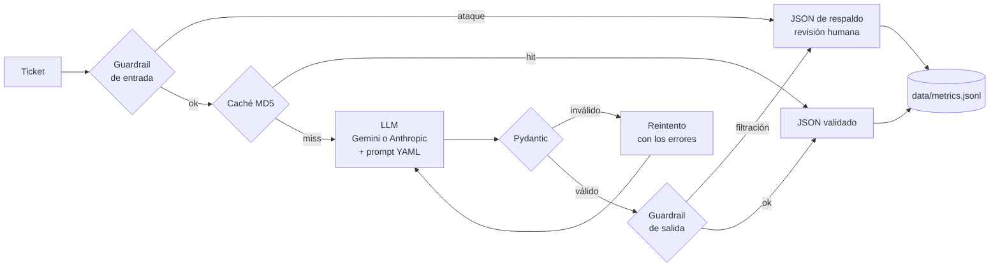
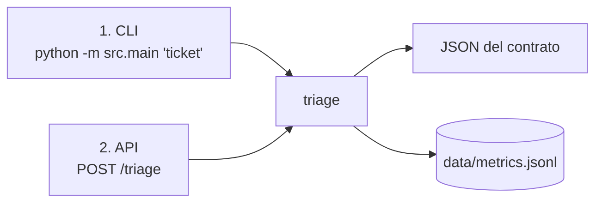

# Nubbix Triage

CLI que recibe un ticket de soporte en texto libre y devuelve, en JSON validado, su categoría, una respuesta propuesta para el cliente y acciones sugeridas para el agente humano. Registra tokens, latencia y costo de cada request, y bloquea intentos de manipulación.

Proyecto Integrador del Módulo 1 — AI Engineering (Henry). Caso: Nubbix, SaaS de gestión para pymes de LATAM con ~400 tickets por día y 9 horas de primera respuesta.

| Accuracy (prompt v2) | JSON válido | Costo por ticket (pago) | Ataques mitigados |
|---|---|---|---|
| 97,5 % en los 2 modelos | 100 % | ~$0,0004 | 10/10 con guardrails |

## Cómo funciona



Contrato de salida (no cambia nunca, ni siquiera ante errores):

```json
{
  "answer": "Lamentamos el cobro duplicado de tu suscripción de este mes. Nuestro equipo de facturación va a revisar los pagos registrados en tu cuenta y te confirmaremos el resultado; ¿puedes indicarnos la fecha y el monto de ambos cargos?",
  "confidence": 0.95,
  "category": "billing",
  "actions": [
    "Revisar en el historial de pagos del cliente si hay dos cargos de la suscripción del mes",
    "Verificar la fecha, el monto y el estado de cada cargo",
    "Iniciar el proceso de reintegro del cargo duplicado si se confirma la duplicidad"
  ]
}
```

`category` es `billing`, `technical`, `account` u `other`. `confidence` va de 0 a 1.

## Instalación

Requisitos: Python 3.12, [uv](https://docs.astral.sh/uv/) (o `pip`) y una API key de Gemini (gratis en [Google AI Studio](https://aistudio.google.com)) o de Anthropic ([platform.claude.com](https://platform.claude.com)).

```bash
uv venv --python 3.12 .venv
source .venv/bin/activate
uv pip install -r requirements.txt
cp .env.example .env    # completar las API keys
```

Cada terminal nueva necesita `source .venv/bin/activate` (debe verse `(.venv)` en el prompt).

## Modos de uso

Hay 2 formas de clasificar tickets. Las 2 usan la misma lógica (`triage()`), devuelven el mismo JSON y registran las mismas métricas.

| | 1. Comando (CLI) | 2. API HTTP (FastAPI) |
|---|---|---|
| Para qué | Probar a mano o desde un script | Integrar con otro sistema (el de tickets de Nubbix) |
| Cómo se llama | `python -m src.main "ticket"` | `POST /triage` con `{"query": "ticket"}` |
| Dónde sale el JSON | stdout | Cuerpo de la respuesta HTTP |
| Cómo saber si falló | Código de salida `1` + mensaje en stderr | Header `X-Triage-Status` |



Si algo falla o se bloquea, los 2 modos devuelven igual un JSON de respaldo con `confidence: 0`, para revisión humana.

### 1. Comando (CLI)

```bash
python -m src.main "me cobraron dos veces la suscripción de este mes"
python -m src.main "el reporte de ventas no carga" --provider anthropic --prompt v1
```

| Opción | Valores | Por defecto |
|---|---|---|
| `--provider` | `gemini`, `anthropic` | `LLM_PROVIDER` en `.env` (`gemini`) |
| `--prompt` | `v1`, `v2` (archivos de `prompts/`) | `v2` |
| `--no-cache` | — | usa la caché |

- **stdout** recibe solo el JSON, listo para otro sistema. Los avisos y errores van a **stderr**.
- **Código de salida:** `0` si el modelo respondió bien; `1` si falló o se bloqueó.

### 2. API HTTP (FastAPI)

Levantar el servidor (la terminal queda ocupada; `Ctrl + C` para pararlo):

```bash
uvicorn src.api:app --reload
```

Desde otra terminal:

```bash
curl -X POST localhost:8000/triage -H "Content-Type: application/json" -d '{"query": "me cobraron dos veces"}'
```

O desde el navegador: http://localhost:8000/docs → `POST /triage` → **Try it out**.

| Endpoint | Qué hace |
|---|---|
| `POST /triage` | Body: `query` (obligatorio), `provider` y `prompt` (opcionales, mismos valores que en la CLI). Responde el JSON del contrato |
| `GET /health` | Devuelve `{"status": "ok"}` si el servidor está activo |

El header `X-Triage-Status` vale `ok` o el motivo del respaldo: `invalid_input`, `blocked_input`, `blocked_output`, `api_error`, `refused`, `invalid_response` o `config_error`.

**Protección:** con `API_TOKEN` en el `.env`, cada request debe mandar el header `X-API-Key` con ese valor (si no, `401`). Cada IP tiene un límite de `RATE_LIMIT_PER_MINUTE` requests por minuto (por defecto 30; si lo supera, `429`).

### Métricas

Cada request (por CLI o por API) agrega una línea a `data/metrics.jsonl` con tokens, latencia, costo y los precios usados.

```bash
jq . data/metrics.jsonl
```

### Evals

```bash
python -m evals.runner --provider anthropic --prompt v2
python -m evals.runner --provider gemini --prompt v2 --delay 4     # capa gratuita: espaciar llamadas
python -m evals.adversarial --provider gemini --delay 4            # 10 ataques, con y sin guardrails
```

Imprimen el score global y por categoría (o la tasa de ataques mitigados) y guardan el detalle en `evals/results/`. `--limit N` corre solo los primeros N casos.

## Recomendaciones

- **Prompt:** usar `v2` (few-shot + reglas). Le gana a `v1` en los 2 modelos: 97,5 % contra 90–92,5 %, y resuelve los casos ambiguos.
- **Modelo para producción:** `claude-haiku-5-5`. Con v2 empata en calidad con Gemini, es 13 % más barato por ticket pagando, su confianza separa aciertos de errores y su latencia es estable.
- **Modelo para desarrollo y pruebas:** `gemini-3.1-flash-lite` en la capa gratuita ($0). No usarlo con datos reales de clientes: en esa capa Google puede usar los datos para mejorar sus productos.
- **Guardrails siempre activos:** sin ellos, Gemini cayó en 3 de 10 ataques (por ejemplo, le prometió a un cliente que su reintegro "ya fue aprobado").
- **Usar `confidence`** para priorizar la revisión humana: con Haiku, debajo de ~0,7 conviene revisar con más cuidado.

## Limitaciones

- Dataset y ataques ficticios y chicos (40 tickets, 10 ataques); las etiquetas no tuvieron una revisión independiente.
- Solo se mide la categoría; la calidad de `answer` y `actions` se revisó a mano en ejemplos.
- El modelo no conoce Nubbix (planes, menús, políticas): el prompt le prohíbe inventarlos. Ese conocimiento llegaría con RAG (Módulo 2).
- Los guardrails son por patrones: un ataque nuevo y bien reformulado puede pasar el filtro de entrada.
- Los precios de `src/pricing.py` se verificaron el 2026-10-29 y se actualizan a mano.

## Estructura

```text
src/        CLI, API, orquestación, contrato, guardrails, métricas, precios, caché y proveedores
prompts/    v1.yaml (zero-shot) y v2.yaml (few-shot + reglas)
evals/      dataset, ataques, runners y resultados
data/       metrics.jsonl (append-only) y caché local
docs/       detalle técnico
```

## Más detalle

| Documento | Contenido |
|---|---|
| [docs/architecture.md](docs/architecture.md) | Componentes, decisiones técnicas y parámetros del modelo |
| [docs/evals.md](docs/evals.md) | Dataset, comparativa v1 vs v2 y Gemini vs Haiku, elección del prompt |
| [docs/security.md](docs/security.md) | Capas de defensa, suite adversarial y ejemplo de ataque |
| [docs/ai-usage.md](docs/ai-usage.md) | Cómo se usó IA en el desarrollo y qué se corrigió con datos |
