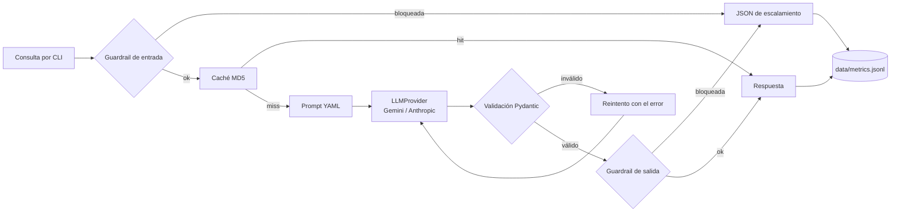
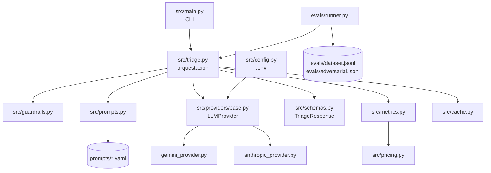

# Nubbix Triage — Soporte nivel 1 con LLMs

Servicio de línea de comandos que recibe una consulta de soporte en texto libre, la clasifica, propone una respuesta y sugiere acciones al agente humano. Devuelve siempre un JSON validado, registra tokens, latencia y costo de cada request, y resiste entradas maliciosas.

Proyecto Integrador del Módulo 1 — AI Engineering (Henry).

> **Estado:** en construcción, commit a commit. Este README describe el plan y la arquitectura objetivo. Las secciones de uso, resultados y decisiones se completan a medida que avanza cada etapa.

---

## 1. Vista de producto

### El problema

Nubbix es un SaaS de gestión para pymes de LATAM con 12.000 clientes.

| Indicador | Valor actual |
|---|---|
| Tickets por día | ~400 |
| Tickets repetitivos (4 tipos) | 60 % (~240 por día) |
| Tiempo de primera respuesta | 9 horas |
| Equipo de nivel 1 | Saturado |

### La solución

Un servicio que hace el primer paso del trabajo del agente de nivel 1:

1. **Clasifica** la consulta en `billing`, `technical`, `account` u `other`.
2. **Propone una respuesta** lista para revisar y enviar.
3. **Sugiere acciones** concretas para el agente (por ejemplo, "verificar cargos duplicados en el panel de pagos").
4. **Indica su confianza**, para que el agente sepa cuándo revisar con más cuidado.

El agente humano sigue teniendo la última palabra. El servicio no responde solo al cliente: le ahorra al agente el tiempo de leer, clasificar y redactar desde cero.

### Usuarios

| Usuario | Qué necesita |
|---|---|
| Agente de soporte nivel 1 | Una clasificación correcta y un borrador de respuesta que pueda usar |
| Líder de soporte | Saber cuánto cuesta el servicio, cuánto tarda y qué tan bien clasifica |
| Sistema de tickets (consumidor del JSON) | Un contrato estable que no cambie ni se rompa |
| Equipo de seguridad | Garantía de que un cliente malicioso no puede manipular el sistema |

### Cómo medimos el éxito

| Pregunta de negocio | Métrica del proyecto |
|---|---|
| ¿Clasifica bien? | Accuracy global y por categoría en el dataset de evals |
| ¿El sistema de tickets puede consumir la salida? | % de respuestas con JSON válido (objetivo: 100 %) |
| ¿Cuánto cuesta? | Costo en USD por request y por corrida de evals |
| ¿Es rápido? | Latencia por request, en segundos |
| ¿Es seguro? | % de ataques de la suite adversarial bloqueados |

### Alcance

**Incluye:** CLI, dos proveedores de LLM intercambiables, prompts versionados, dataset de evaluación, runner de evals, métricas en JSONL, guardrails de entrada y salida, suite adversarial, caché y comparativa de modelos.

**No incluye:** integración real con el sistema de tickets, envío automático de respuestas al cliente, interfaz web, base de datos, RAG (eso llega en el Módulo 2).

---

## 2. Vista técnica y de arquitectura

### Contrato de salida

Todo request devuelve exactamente este JSON, también cuando hay un error o un bloqueo de seguridad:

```json
{
  "answer": "Hola, lamentamos el doble cobro. Ya derivamos tu caso al equipo de facturación...",
  "confidence": 0.92,
  "category": "billing",
  "actions": [
    "Verificar cargos duplicados del mes en el panel de pagos",
    "Iniciar reintegro del cargo duplicado"
  ]
}
```

| Campo | Tipo | Regla |
|---|---|---|
| `answer` | `string` | No vacío |
| `confidence` | `float` | Entre 0 y 1 |
| `category` | `string` | Uno de `billing`, `technical`, `account`, `other` |
| `actions` | `list[string]` | Al menos una acción |

### Flujo de un request



### Componentes



| Módulo | Responsabilidad |
|---|---|
| `src/main.py` | Leer argumentos de la CLI e imprimir el JSON |
| `src/triage.py` | Orquestar el flujo: guardrails, prompt, LLM, validación, métricas |
| `src/providers/` | Una clase por proveedor detrás de la interfaz `LLMProvider` |
| `src/schemas.py` | Contrato `TriageResponse` en Pydantic |
| `src/prompts.py` | Cargar y renderizar la versión de prompt elegida |
| `src/guardrails.py` | Detección de injection, moderación y validación de la salida |
| `src/metrics.py` | Escribir una línea por request en `data/metrics.jsonl` |
| `src/pricing.py` | Precios por modelo, con fuente y fecha |
| `src/cache.py` | Caché por hash MD5 de consulta + prompt + modelo |
| `evals/runner.py` | Correr el dataset y reportar score global y por categoría |

### Decisiones técnicas

| Decisión | Elección | Motivo |
|---|---|---|
| Lenguaje | Python 3.12 | Pydantic y los SDK oficiales de ambos proveedores |
| Proveedores | Gemini y Anthropic | Dos SDK oficiales con APIs distintas: obligan a una abstracción real |
| Modelos | `gemini-3.1-flash-lite` y `claude-haiku-5-5` | Los más económicos y vigentes de cada marca (verificado el 2026-10-29). Gemini tiene capa gratuita: las pruebas cuestan $0. Se descartó `gpt-5-nano` porque OpenAI lo apaga el 2026-12-11 |
| Abstracción | Interfaz mínima `LLMProvider` | Cambiar de proveedor sin tocar la lógica de negocio, sin armar un framework |
| Validación | Pydantic + reintento con el error | El modelo no siempre respeta el contrato; el error le indica qué corregir |
| Prompts | Archivos YAML versionados | El prompt se trata como código y se compara con datos |
| Métricas | JSONL append-only | Simple y auditable; la consigna pide no usar base de datos |
| Costo | Precio por MTok guardado en cada línea | Cualquiera puede recalcular el costo y llegar al mismo número |
| Seguridad | Defensa en capas | Un solo guardrail se evade con variaciones triviales |
| Evals | Script simple | La complejidad va en el prompt y los evals, no en las herramientas |

### Estructura del repositorio (objetivo)

```text
.
├── src/
│   ├── main.py
│   ├── triage.py
│   ├── config.py
│   ├── schemas.py
│   ├── prompts.py
│   ├── guardrails.py
│   ├── metrics.py
│   ├── pricing.py
│   ├── cache.py
│   └── providers/
│       ├── base.py
│       ├── gemini_provider.py
│       └── anthropic_provider.py
├── prompts/
│   ├── v1_zero_shot.yaml
│   └── v2_few_shot.yaml
├── evals/
│   ├── dataset.jsonl
│   ├── adversarial.jsonl
│   ├── runner.py
│   └── results/
├── data/
│   └── metrics.jsonl
├── docs/
│   └── ai-usage.md
├── .env.example
├── requirements.txt
└── README.md
```

---

## 3. Plan de construcción

El proyecto se construye en 20 commits chicos. Cada commit agrega una sola pieza, se explica y se verifica antes de pasar al siguiente.

| Etapa | Commits | Resultado | Criterio de la rúbrica |
|---|---|---|---|
| A. Base del repo | 1–2 | Repo autocontenido, configuración por `.env` | Repositorio |
| B. Flujo principal | 3–6 | **Hito 1:** la CLI devuelve JSON válido | Funcionalidad y contrato |
| C. Robustez | 7–9 | Dos proveedores, reintento, manejo de errores | Funcionalidad y contrato |
| D. Observabilidad | 10–11 | **Hito 2:** métricas en `data/metrics.jsonl` | Observabilidad |
| E. Prompts y evals | 12–16 | **Hito 3:** comparativa v1 vs v2 con datos | Evals y prompting |
| F. Seguridad | 17–19 | Guardrails y suite adversarial | Seguridad |
| G. Cierre | 20 + docs | Caché, comparativa de modelos, README final | Extra credits |

| # | Commit |
|---|---|
| 1 | `chore: estructura inicial, gitignore y dependencias` |
| 2 | `chore: configuración por variables de entorno` |
| 3 | `feat: contrato TriageResponse con Pydantic` |
| 4 | `feat: interfaz LLMProvider` |
| 5 | `feat: proveedor Gemini` |
| 6 | `feat: CLI básica de triage` |
| 7 | `feat: proveedor Anthropic y selección por --provider` |
| 8 | `feat: reintento ante JSON inválido` |
| 9 | `feat: manejo de errores de API` |
| 10 | `feat: tabla de precios por modelo` |
| 11 | `feat: registro de métricas en JSONL` |
| 12 | `feat: prompts versionados en YAML (v1 zero-shot)` |
| 13 | `feat: prompt v2 few-shot con reglas` |
| 14 | `feat: dataset de evaluación (≥30 casos)` |
| 15 | `feat: runner de evals con score global y por categoría` |
| 16 | `docs: comparativa v1 vs v2 y elección de prompt` |
| 17 | `feat: guardrail de entrada en capas` |
| 18 | `feat: guardrail de salida y token canario` |
| 19 | `feat: suite adversarial (bonus)` |
| 20 | `feat: caché MD5 + comparativa de modelos` |

---

## 4. Instalación y uso

_Se completa en los commits 1, 2 y 6._

## 5. Resultados de evals

_Se completa en los commits 15 y 16._

## 6. Seguridad

_Se completa en los commits 17 a 19._

## 7. Limitaciones

_Se completa al cierre._

## 8. Uso de IA en el desarrollo

_Se registra en `docs/ai-usage.md` a lo largo del proyecto._
