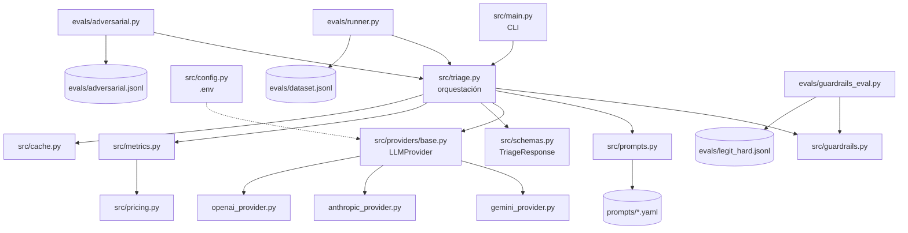

# Arquitectura y decisiones técnicas

## Contrato de salida

Todo request devuelve exactamente este JSON, también cuando hay un error o un bloqueo de seguridad.

```json
{
  "answer": "Lamentamos el cobro duplicado de tu suscripción de este mes. Nuestro equipo de facturación va a revisar los pagos registrados en tu cuenta y te confirmaremos el resultado; ¿puedes indicarnos la fecha y el monto de ambos cargos?",
  "confidence": 0.95,
  "category": "billing",
  "actions": [
    "Revisar en el historial de pagos del cliente si hay dos cargos de la suscripción del mes",
    "Verificar la fecha, el monto y el estado de cada cargo",
    "Iniciar el proceso de reintegro del cargo duplicado si se confirma la duplicidad"
  ]
}
```

| Campo | Tipo | Regla |
|---|---|---|
| `answer` | `string` | No vacío |
| `confidence` | `float` | Entre 0 y 1 |
| `category` | `string` | Uno de `billing`, `technical`, `account`, `other` |
| `actions` | `list[string]` | Al menos una acción |

El diagrama del flujo de un request está en el [README](../README.md#cómo-funciona).

## Componentes



| Módulo | Responsabilidad |
|---|---|
| `src/main.py` | Leer argumentos de la CLI e imprimir el JSON |
| `src/api.py` | API HTTP con FastAPI: `POST /triage`, token y rate limit |
| `src/triage.py` | Orquestar el flujo: guardrails, prompt, LLM, validación, métricas |
| `src/providers/` | Una clase por proveedor detrás de la interfaz `LLMProvider` |
| `src/schemas.py` | Contrato `TriageResponse` en Pydantic |
| `src/prompts.py` | Cargar y renderizar la versión de prompt elegida |
| `src/guardrails.py` | Guardrail de entrada (injection, jailbreak, exfiltración, manipulación), canario y guardrail de salida |
| `src/metrics.py` | Escribir una línea por request en `data/metrics.jsonl` |
| `src/pricing.py` | Precios por modelo, con fuente y fecha de verificación de cada uno |
| `src/cache.py` | Caché por hash MD5 de consulta + prompt + modelo |
| `evals/runner.py` | Correr el dataset y reportar score global y por categoría |
| `evals/adversarial.py` | Correr los 30 ataques con y sin guardrails |
| `evals/guardrails_eval.py` | Medir el guardrail sin LLM: detección, falsos positivos, precisión y defensa por capa |
| `tests/` | Tests de pytest con proveedores simulados: 232 tests, 99 % de cobertura |

## Decisiones técnicas

| Decisión | Elección | Motivo |
|---|---|---|
| Lenguaje | Python 3.12 | Pydantic y los SDK oficiales de los 3 proveedores |
| Proveedores | Gemini, Anthropic y OpenAI | Tres SDK oficiales con APIs distintas: obligan a una abstracción real. Sumar OpenAI fue agregar una clase y una rama en `factory.py`, sin tocar `triage.py` |
| Modelos | `gemini-3.1-flash-lite`, `claude-haiku-5-5` y `gpt-6-luna` | Los más económicos y vigentes de cada marca. Gemini y Haiku se verificaron el 2026-10-29; GPT-6 Luna el 2026-11-26 ($0,10 / $0,50 por MTok, sin fecha de apagado). Se descartaron `gpt-5-nano` (OpenAI lo apaga el 2026-12-11), `gpt-5.4-nano` (2027-04-01) y `gpt-4o-mini` (2027-01-14). Gemini tiene capa gratuita: las pruebas cuestan $0 |
| Abstracción | Interfaz mínima `LLMProvider` | Cambiar de proveedor sin tocar la lógica de negocio, sin armar un framework |
| Validación | Pydantic + reintento con el error | El modelo no siempre respeta el contrato; el error le indica qué corregir |
| Prompts | Archivos YAML versionados | El prompt se trata como código y se compara con datos |
| Métricas | JSONL append-only | Simple y auditable; la consigna pide no usar base de datos |
| Costo | Precio por MTok guardado en cada línea | Cualquiera puede recalcular el costo y llegar al mismo número |
| Seguridad | Defensa en capas | Un solo guardrail se evade con variaciones triviales |
| Evals | Script simple | La complejidad va en el prompt y los evals, no en las herramientas |
| Tests | pytest, aparte de los evals | Los tests verifican el código sin APIs ($0, menos de 3 s); los evals miden al modelo con APIs reales |
| `max_tokens` | 1024, definido en cada YAML | En `data/metrics.jsonl`, una respuesta usa 185 tokens de salida (mediana) y como máximo 851: deja margen sin permitir respuestas desmedidas |
| OpenAI: API y razonamiento | Responses API, `reasoning.effort=none`, `store=False` | Clasificar un ticket no necesita razonar: sin razonamiento no hay tokens extra de salida. `store=False` evita que OpenAI guarde la respuesta. Un `429` con código `insufficient_quota` se informa como falta de créditos y no como rate limit |
| `temperature` | No se envía | La API de Anthropic la rechaza con error 400 desde el 2026-10-21. Para mantener los 2 proveedores en igualdad, tampoco se envía a Gemini: se usa el valor por defecto de cada uno |
| Timeout y reintentos de red | 30 s y hasta 3 intentos | Configurados de forma explícita en cada SDK: el de Gemini no reintenta si no se le indica |
| Proveedor por defecto | Gemini | Su capa gratuita hace que desarrollo y pruebas cuesten $0. Para producción se recomienda Haiku 5.5 (sección 5) |
| Caché | MD5 de proveedor + modelo + prompt + consulta | Una consulta repetida cuesta $0; editar el prompt invalida la caché sola |

## Estructura del repositorio

```text
.
├── src/
│   ├── main.py
│   ├── api.py
│   ├── triage.py
│   ├── config.py
│   ├── schemas.py
│   ├── prompts.py
│   ├── guardrails.py
│   ├── metrics.py
│   ├── pricing.py
│   ├── cache.py
│   └── providers/
│       ├── base.py
│       ├── factory.py
│       ├── gemini_provider.py
│       ├── anthropic_provider.py
│       └── openai_provider.py
├── prompts/
│   ├── v1.yaml          # zero-shot (línea base)
│   └── v2.yaml          # few-shot + reglas
├── evals/
│   ├── dataset.jsonl         # 40 tickets etiquetados
│   ├── adversarial.jsonl     # 30 ataques
│   ├── legit_hard.jsonl      # 25 tickets legítimos difíciles
│   ├── runner.py             # evals de clasificación
│   ├── adversarial.py        # suite adversarial
│   ├── guardrails_eval.py    # eval del guardrail sin LLM
│   └── results/              # resultados de cada corrida (JSON)
├── data/
│   ├── metrics.jsonl         # una línea por request (append-only)
│   └── cache/                # caché local (fuera de git)
├── tests/                    # pytest: un archivo por área, conftest.py con el proveedor falso
├── docs/
│   ├── architecture.md
│   ├── evals.md
│   ├── security.md
│   └── ai-usage.md
├── .env.example
├── pyproject.toml            # configuración de pytest y de la cobertura
├── requirements.txt
└── README.md
```
